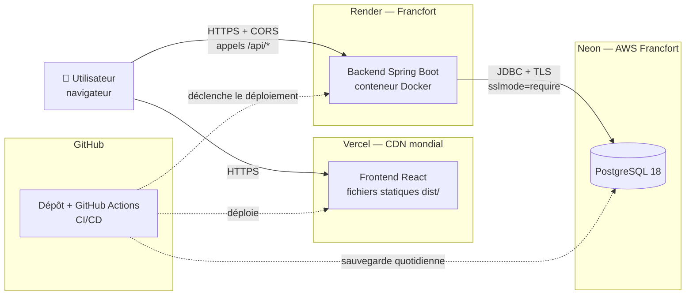
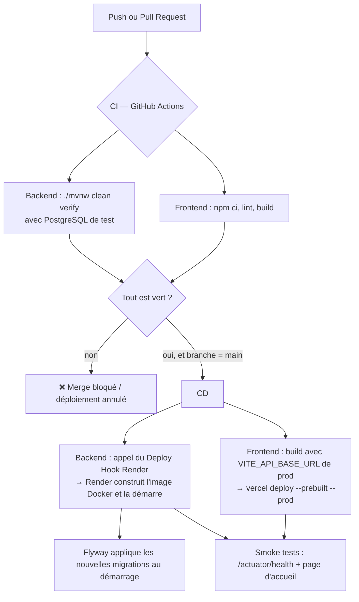

# Architecture de déploiement — EduAdvice

> **Statut :** proposé — à valider par l'équipe
> **Responsable DevOps :** Oumar
> **Dernière mise à jour :** novembre 2026

Ce document décrit **où** et **comment** EduAdvice est exécuté, de la machine du
développeur jusqu'à la production, ainsi que les décisions qui justifient ces choix.

---

## 1. Contexte et contraintes

| Contrainte | Conséquence sur l'architecture |
|---|---|
| Projet universitaire, **budget 0 €** | Offres gratuites uniquement (Vercel Hobby, Render Free, Neon Free) |
| Usage non commercial | Compatible avec les conditions de Vercel Hobby |
| Équipe de 4 personnes, 1 profil DevOps débutant | Services managés (PaaS) plutôt qu'un serveur à administrer |
| Utilisateurs en France | Hébergement en **Europe (Francfort)** |
| Application surtout en **lecture** (consultation de formations) | Pas de forte charge en écriture ; une seule instance backend suffit |
| Stack imposée : React + Vite, Java 21 + Spring Boot, PostgreSQL, GitHub Actions | — |

---

## 2. Vue d'ensemble

**Points clés :**

- Le **frontend** n'est qu'un ensemble de fichiers statiques (HTML/CSS/JS) servis par un CDN.
  Le code React s'exécute **dans le navigateur** de l'utilisateur.
- C'est donc le **navigateur** qui appelle le backend, sur un autre domaine →
  le backend doit autoriser l'origine du frontend (**CORS**).
- Le frontend **ne parle jamais** à la base de données.
- Backend et base sont dans **la même région** (Francfort) pour limiter la latence.

### URLs publiques (à confirmer lors de la création des services)

| Composant | URL |
|---|---|
| Frontend | `https://eduadvice.vercel.app` |
| Backend API | `https://eduadvice-api.onrender.com/api` |
| Health check | `https://eduadvice-api.onrender.com/actuator/health` |

HTTPS est fourni **automatiquement** par Vercel et Render (certificats TLS gérés et renouvelés par la plateforme).

---

## 3. Choix des hébergeurs

| Composant | Hébergeur retenu | Pourquoi | Alternatives écartées |
|---|---|---|---|
| Frontend | **Vercel** (Hobby) | Spécialisé dans les sites statiques/Vite, CDN mondial, HTTPS auto, déploiement via CLI | Netlify, Cloudflare Pages (équivalents — choix de familiarité) |
| Backend | **Render** (Free, Docker) | Exécute n'importe quel conteneur Docker, HTTPS auto, variables d'environnement chiffrées, *deploy hooks* | Railway (plus d'offre gratuite durable), Fly.io (carte bancaire requise), VPS (trop d'administration pour démarrer) |
| Base de données | **Neon** (Free) | PostgreSQL managé, gratuit sans expiration, branches, restauration à un instant T | Render Postgres (base gratuite supprimée après expiration), Supabase (plus large que nécessaire) |
| CI/CD | **GitHub Actions** | Imposé ; intégré au dépôt | — |

---

## 4. Environnements

Un **environnement** est un ensemble complet (code + configuration + base de données) isolé des autres.
Le **même code** tourne partout ; seule la **configuration** change (principe *12-Factor App*).

| | **Développement** | **Test / CI** | **Production** |
|---|---|---|---|
| **Où** | Poste du développeur | Runner GitHub Actions (machine jetable) | Vercel + Render + Neon |
| **Frontend** | `npm run dev` (Vite, port 5173) | `npm ci && npm run build` | Fichiers `dist/` sur Vercel |
| **Backend** | `./mvnw spring-boot:run` | `./mvnw clean verify` | Conteneur Docker sur Render |
| **Base** | PostgreSQL 18 via `compose.yaml` | PostgreSQL 18 en *service container*, détruit après le job | Neon (persistante, sauvegardée) |
| **Données** | Données de test locales | Base vide + migrations Flyway | Données réelles |
| **Secrets** | Valeurs de dev non sensibles | GitHub Secrets | Variables d'environnement Render / GitHub Secrets |
| **Déclenché par** | Le développeur | Chaque push / pull request | Merge sur `main` avec CI au vert |

> Un environnement de **staging** (pré-production) n'est pas prévu au départ pour rester dans
> les offres gratuites. Voir [§ 10 Évolutions](#10-évolutions-possibles).

---

## 5. Chaîne CI/CD

**Règles :**

1. On ne déploie **que** depuis `main`, et **seulement si la CI est verte**.
2. Le déploiement automatique « à chaque push » des plateformes est **désactivé** : c'est GitHub Actions qui orchestre.
3. Les migrations de schéma (Flyway) s'exécutent au démarrage du backend. C'est acceptable car il n'y a **qu'une seule instance**.
4. **Retour arrière (rollback)** : Render et Vercel conservent les déploiements précédents → redéploiement en un clic. Une migration de base, elle, ne s'annule pas : on corrige par une nouvelle migration.

---

## 6. Configuration et secrets

**Règle absolue :** aucun secret dans le dépôt Git. Le dépôt est **public**.

| Variable | Utilisée par | Stockée dans | Secret ? |
|---|---|---|---|
| `DB_URL` | Backend | Render (env) | Oui (contient l'hôte) |
| `DB_USERNAME` | Backend | Render (env) | Oui |
| `DB_PASSWORD` | Backend | Render (env) | **Oui** |
| `SPRING_PROFILES_ACTIVE=prod` | Backend | Render (env) | Non |
| `CORS_ALLOWED_ORIGINS` | Backend | Render (env) | Non |
| `VITE_API_BASE_URL` | Frontend (au **build**) | GitHub Actions (variable) | **Non — public** |
| `RENDER_DEPLOY_HOOK_URL` | GitHub Actions | GitHub Secrets | **Oui** |
| `VERCEL_TOKEN`, `VERCEL_ORG_ID`, `VERCEL_PROJECT_ID` | GitHub Actions | GitHub Secrets | **Oui** (token) |
| `BACKUP_DATABASE_URL`, `BACKUP_PASSPHRASE` | Workflow de sauvegarde | GitHub Secrets | **Oui** |

> ⚠️ **Toute variable `VITE_*` est intégrée en clair dans le JavaScript envoyé au navigateur.**
> Elle est donc lisible par n'importe qui : on n'y met **jamais** de secret.

> ℹ️ Configurer les GitHub Secrets nécessite le rôle **Admin** sur le dépôt.

---

## 7. Sécurité

| Mesure | Mise en œuvre |
|---|---|
| HTTPS partout | Automatique sur Vercel et Render ; redirection HTTP → HTTPS |
| Chiffrement vers la base | `sslmode=require` dans l'URL JDBC Neon |
| CORS | Le backend n'autorise **que** l'origine du frontend de prod (pas de `*`) |
| Profil de production | `SPRING_PROFILES_ACTIVE=prod` : pas de `show-sql`, pas de devtools, erreurs sans stack trace |
| Schéma protégé | `ddl-auto: validate` — Hibernate ne modifie jamais le schéma ; seul Flyway le fait |
| Moindre privilège | Jetons de déploiement limités à un projet ; accès en lecture seule pour la sauvegarde (évolution) |
| Image Docker | Image d'exécution minimale (JRE seul), utilisateur non-root |

---

## 8. Base de données et sauvegardes

- **Schéma** : géré exclusivement par les migrations Flyway (`backend/src/main/resources/db/migration`).
- **Connexion** : connexion **directe** Neon (pas le *pooler*), suffisante pour une instance unique.
- **Sauvegardes — deux niveaux :**
  1. **Neon** : restauration à un instant T (*point-in-time restore*) intégrée, sur une fenêtre courte en offre gratuite.
  2. **EduAdvice** : workflow GitHub Actions planifié (quotidien) qui exécute `pg_dump`, **chiffre** le fichier,
     et le conserve comme artefact (rétention 30 jours). Le chiffrement est indispensable car le dépôt est public.
- **Test de restauration** : une sauvegarde non testée n'est pas une sauvegarde → restauration testée en local
  au moins une fois (procédure dans le guide de déploiement).

---

## 9. Disponibilité et limites connues

| Limite (offres gratuites) | Impact | Atténuation |
|---|---|---|
| Render Free : mise en veille après **15 min** sans trafic | Première requête après une période d'inactivité : **~30 à 60 s** | Message de chargement côté frontend ; documenté pour la démo ; ping avant une démonstration |
| Render Free : **512 Mo RAM, 0,1 CPU** | Démarrage lent de Spring Boot, risque de manque de mémoire | Réglage de la mémoire JVM (`-XX:MaxRAMPercentage`), image légère |
| Render Free : 750 h d'instance / mois | Suffisant pour **un seul** service | Ne pas créer d'autre service gratuit dans le même espace |
| Neon Free : base suspendue après **5 min** d'inactivité | Quelques centaines de ms au réveil | Négligeable pour cet usage |
| Neon Free : stockage limité par projet | Largement suffisant pour un catalogue de formations | Surveillance dans le tableau de bord Neon |
| Vercel Hobby : usage non commercial uniquement | Conforme au cadre universitaire | Passer sur une offre payante si le projet devient commercial |

**Supervision :** endpoint `/actuator/health` (vérifié par Render et par les smoke tests) et journaux
consultables dans les tableaux de bord Render et Vercel.

---

## 10. Évolutions possibles

- **Staging** : branche Neon dédiée + second service backend + déploiements *preview* Vercel.
- **Image Docker construite en CI** et publiée sur GitHub Container Registry, pour déployer *exactement* l'artefact testé.
- **Pas de mise en veille** : passage à une offre payante Render.
- **Domaine personnalisé** (ex. `eduadvice.fr`).
- **Rôles PostgreSQL séparés** : un rôle propriétaire pour les migrations, un rôle applicatif aux droits limités.

---

## 11. Décisions d'architecture (résumé)

| # | Décision | Raison principale |
|---|---|---|
| D1 | PaaS (Vercel + Render + Neon) plutôt qu'un VPS | Coût nul, pas de serveur à administrer, HTTPS automatique |
| D2 | Backend packagé en **image Docker** | Même artefact en local et en prod ; portable vers un autre hébergeur |
| D3 | Région **Francfort** pour backend et base | Proximité des utilisateurs et latence backend ↔ base minimale |
| D4 | Appels directs navigateur → API avec **CORS restreint** | Architecture simple ; origine autorisée explicitement |
| D5 | Schéma géré par **Flyway**, `ddl-auto: validate` | Schéma versionné, identique dans tous les environnements |
| D6 | GitHub Actions **orchestre** les déploiements (auto-deploy des plateformes désactivé) | Aucun déploiement sans CI verte |
| D7 | Sauvegarde quotidienne **chiffrée** via `pg_dump` en plus de Neon | Ne pas dépendre d'un seul fournisseur ; dépôt public |
