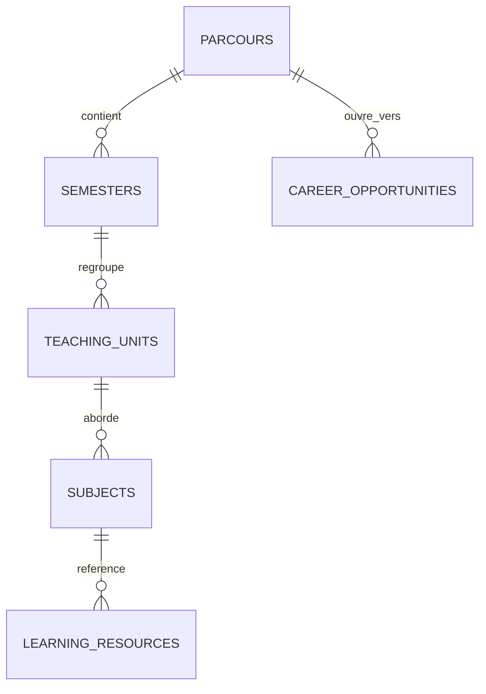
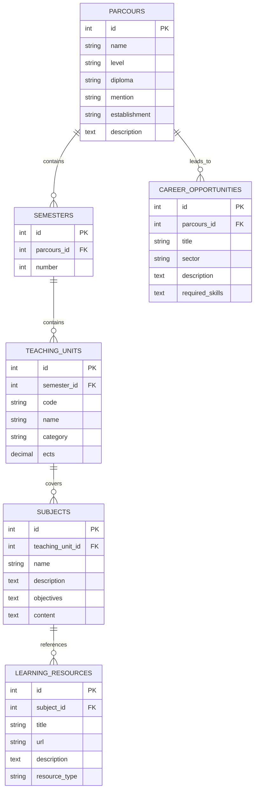

# Conception de la base de données

## Objectif
La base de données d'EduAdvice a pour objectif de structurer et centraliser les informations relatives aux formations universitaires, à leur organisation pédagogique, aux ressources d'apprentissage associées et aux débouchés professionnels.

Elle doit permettre aux utilisateurs de :

- Consulter les formations proposées par les établissements.
- Comprendre l'organisation des formations par semestre et par unité d'enseignement (UE).
- Découvrir les enseignements et les notions abordées dans chaque UE.
- Accéder aux ressources pédagogiques associées aux différentes notions.
- Identifier les débouchés professionnels accessibles après une formation.

Pour le MVP, nous avons opté pour une base de données relationnelle organisée autour de six entités principales.

Cette architecture volontairement simplifiée permet de couvrir les besoins fonctionnels essentiels de l'application, tout en limitant la complexité technique et en facilitant les évolutions futures.

## Modèle conceptuel (MCD)
Le modèle conceptuel de données représente les principales entités du système ainsi que leurs associations, indépendamment de leur implémentation technique.

Le modèle d'EduAdvice repose sur six entités principales.

| Entité | Description |
| --- | --- |
| PARCOURS | Représente une formation universitaire proposée par un établissement. Elle contient les informations générales permettant de présenter et d'identifier la formation. |
| SEMESTERS | Représente les semestres qui composent un parcours universitaire. Chaque semestre possède un numéro et appartient à un seul parcours. |
| TEACHING_UNITS | Représente les unités d'enseignement (UE) qui composent un semestre. Une UE correspond à un enseignement ou à un ensemble pédagogique identifié, possédant notamment un nom, une catégorie et un nombre de crédits ECTS. |
| SUBJECTS | Représente les notions et les thèmes abordés au sein d'une unité d'enseignement. Par exemple, une UE intitulée « Algebra 1 » peut aborder la théorie des ensembles, le raisonnement logique et les démonstrations mathématiques. |
| LEARNING_RESOURCES | Représente les ressources pédagogiques associées aux notions étudiées : documents, vidéos, exercices, sites web ou outils. |
| CAREER_OPPORTUNITIES | Représente les métiers et les débouchés professionnels associés à un parcours universitaire. |

### Représentation du Modèle conceptuel

## Modèle logique (MLD)
Le modèle logique de données traduit le modèle conceptuel en une structure relationnelle. Il définit les tables, leurs attributs, les clés primaires et étrangères ainsi que les contraintes nécessaires à la cohérence des données.

### Diagramme relationnel

### Cardinalités
| Relation | Cardinalité | Explication |
| --- | --- | --- |
| PARCOURS – SEMESTERS | 1,N | Un parcours contient un ou plusieurs semestres. Un semestre appartient à un seul parcours. |
| PARCOURS – CAREER_OPPORTUNITIES | 1,N | Un parcours peut conduire à plusieurs métiers. Un métier enregistré est associé à un seul parcours. |
| SEMESTERS – TEACHING_UNITS | 1,N | Un semestre contient une ou plusieurs UE. Une UE appartient à un seul semestre. |
| TEACHING_UNITS – SUBJECTS | 1,N | Une UE peut aborder plusieurs notions. Une notion appartient à une seule UE. |
| SUBJECTS – LEARNING_RESOURCES | 1,N | Une notion peut posséder plusieurs ressources. Une ressource est associée à une seule notion. |

## Dictionnaire de données
Le dictionnaire de données détaille les différentes tables, leurs attributs, leurs types ainsi que les contraintes appliquées.

Les contraintes permettent de garantir la cohérence des informations enregistrées et d'éviter les doublons.

Les principales contraintes utilisées sont :

| Contrainte | Signification |
| --- | --- |
| `PK` (Primary Key) | Identifiant unique d'un enregistrement. |
| `FK` (Foreign Key) | Référence vers une clé primaire d'une autre table. |
| `NOT NULL` | Champ obligatoire qui ne peut pas être vide. |
| `UNIQUE` | Empêche les doublons sur un champ ou une combinaison de champs. |
| `CHECK` | Vérifie qu'une valeur respecte une condition définie. |

Les identifiants id sont des clés primaires auto-générées. Ils sont donc automatiquement uniques et non nuls.

### Table PARCOURS
Cette table contient les informations générales des formations universitaires proposées par les établissements.

| Attribut | Type | Contraintes | Description |
| --- | --- | --- | --- |
| id | INT | PK | Identifiant unique du parcours. |
| name | VARCHAR | NOT NULL | Nom de la formation. |
| level | VARCHAR | NOT NULL | Niveau d'études (Licence, Master, etc.). |
| diploma | VARCHAR | NOT NULL | Diplôme préparé. |
| mention | VARCHAR | NULL | Mention de la formation. |
| establishment | VARCHAR | NOT NULL | Établissement proposant la formation. |
| description | TEXT | NULL | Description générale du parcours. |

### Table SEMESTERS
Cette table représente les semestres qui composent un parcours universitaire.

| Attribut | Type | Contraintes | Description |
| --- | --- | --- | --- |
| id | INT | PK | Identifiant unique du semestre. |
| parcours_id | INT | FK, NOT NULL | Référence au parcours associé. |
| number | INT | NOT NULL, CHECK | Numéro du semestre. |

Contraintes :

- `UNIQUE (parcours_id, number)` : empêche la création de deux semestres portant le même numéro dans un parcours.
- `CHECK (number > 0)` : garantit que le numéro du semestre est positif.

Un parcours peut donc posséder un semestre 1 et un semestre 2, mais ne peut pas posséder deux semestres 1.

### Table TEACHING_UNITS
Cette table représente les unités d'enseignement (UE) qui composent les semestres.

*Note : Une UE correspond à un enseignement identifié, comme « Algebra 1 », « Introduction to Programming » ou « Calculus 1 ».*

| Attribut | Type | Contraintes | Description |
| --- | --- | --- | --- |
| id | INT | PK | Identifiant unique de l'UE. |
| semester_id | INT | FK, NOT NULL | Référence au semestre associé. |
| code | VARCHAR | NULL | Code officiel de l'unité d'enseignement. |
| name | VARCHAR | NOT NULL | Nom de l'enseignement. |
| category | VARCHAR(20) | NOT NULL, CHECK | Catégorie de l'UE. |
| ects | DECIMAL(4,1) | NOT NULL, CHECK | Nombre de crédits ECTS attribués à l'UE. |

pour l'attribut `category` les valeurs autorisées sont :
| Valeur technique | Signification |
| --- | --- |
| `MAJOR_1` | UE majeure 1. |
| `MAJOR_2` | UE majeure 2. |
| `MINOR` | UE mineure. |
| `TRANSVERSAL` | UE transversale. |

Contraintes :

- `UNIQUE (semester_id, code)` : empêche deux UE d'avoir le même code dans un même semestre, lorsque le code est renseigné.
- `CHECK (category IN ('MAJOR_1', 'MAJOR_2', 'MINOR', 'TRANSVERSAL'))` : limite les catégories aux valeurs autorisées.
- `CHECK (ects > 0)` : empêche l'attribution d'un nombre de crédits nul ou négatif.

Le champ `code` reste facultatif, car toutes les maquettes pédagogiques ne fournissent pas nécessairement un code pour chaque UE.

### Table SUBJECTS

Cette table représente les notions et les thèmes abordés au sein des unités d'enseignement.

Contrairement aux UE, les sujets ne représentent pas des enseignements complets, mais les différents concepts étudiés dans ces enseignements.

*Par exemple, une UE appelée « Algebra 1 » peut aborder la théorie des ensembles, le raisonnement logique et les démonstrations mathématiques.*

| Attribut | Type | Contraintes | Description |
| --- | --- | --- | --- |
| id | INT | PK | Identifiant unique du sujet. |
| teaching_unit_id | INT | FK, NOT NULL | Référence à l'UE associée. |
| name | VARCHAR | NOT NULL | Nom de la notion abordée. |
| description | TEXT | NULL | Description de la notion. |
| objectives | TEXT | NULL | Objectifs pédagogiques associés. |
| content | TEXT | NULL | Contenu détaillé de la notion. |

Contraintes :

- `UNIQUE (teaching_unit_id, name)` : empêche d'enregistrer deux sujets portant le même nom au sein d'une même UE.

Cette contrainte permet néanmoins de retrouver une même notion dans plusieurs UE différentes.

### Table LEARNING_RESOURCES

Cette table centralise les ressources pédagogiques associées aux notions étudiées.

Elle permet notamment de référencer des documents, des vidéos, des exercices ou des outils complémentaires.

| Attribut | Type | Contraintes | Description |
| --- | --- | --- | --- |
| id | INT | PK | Identifiant unique de la ressource. |
| subject_id | INT | FK, NOT NULL | Référence au sujet associé. |
| title | VARCHAR | NOT NULL | Titre de la ressource. |
| url | VARCHAR | NOT NULL | Adresse URL de la ressource. |
| description | TEXT | NULL | Description complémentaire. |
| resource_type | VARCHAR(20) | NOT NULL, CHECK | Catégorie de la ressource. |

Pour l'attribut `resource_type` les valeurs autorisées sont :
| Valeur technique | Libellé affiché | Description |
| --- | --- | --- |
| `DOCUMENT` | Document | PDF, supports de cours et fiches de révision. |
| `VIDEO` | Vidéo | Cours vidéo, tutoriels et conférences. |
| `WEBSITE` | Site web | Articles, documentations et sites pédagogiques. |
| `EXERCISE` | Exercice | Exercices pratiques, QCM et sujets d'examen. |
| `TOOL` | Outil | Logiciels, simulateurs et plateformes interactives. |
| `OTHER` | Autre | Ressources ne correspondant pas aux catégories précédentes. |

Contraintes :
- `UNIQUE (subject_id, url)` : empêche d'enregistrer deux fois le même lien pour une même notion.
- `CHECK (resource_type IN ('DOCUMENT', 'VIDEO', 'WEBSITE', 'EXERCISE', 'TOOL', 'OTHER'))` : limite les types de ressources aux catégories autorisées.

Le choix d'une liste fixe de catégories permet de standardiser les ressources et d'éviter les différences d'écriture.

### Table CAREER_OPPORTUNITIES

Cette table regroupe les métiers et les débouchés professionnels associés aux parcours universitaires.
| Attribut | Type | Contraintes | Description |
| --- | --- | --- | --- |
| id | INT | PK | Identifiant unique du débouché. |
| parcours_id | INT | FK, NOT NULL | Référence au parcours associé. |
| title | VARCHAR | NOT NULL | Intitulé du métier. |
| sector | VARCHAR | NULL | Secteur professionnel concerné. |
| description | TEXT | NULL | Description du métier. |
| required_skills | TEXT | NULL | Compétences généralement attendues. |

Contrainte supplémentaire :

- `UNIQUE (parcours_id, title)` : empêche d'associer deux fois le même métier au même parcours.

Un métier peut néanmoins être associé à plusieurs parcours différents. Dans ce cas, il sera enregistré une fois pour chaque parcours concerné.

### Règles d'intégrité référentielle
Les clés étrangères permettent de garantir que les enregistrements enfants font référence à des enregistrements parents existants.

Pour le MVP, nous proposons également d'utiliser la suppression en cascade (`ON DELETE CASCADE`) sur les relations hiérarchiques.

| Relation | Comportement | Conséquence |
| --- | --- | --- |
| PARCOURS → SEMESTERS | CASCADE | La suppression d'un parcours supprime ses semestres. |
| SEMESTERS → TEACHING_UNITS | CASCADE | La suppression d'un semestre supprime ses UE. |
| TEACHING_UNITS → SUBJECTS | CASCADE | La suppression d'une UE supprime ses sujets. |
| SUBJECTS → LEARNING_RESOURCES | CASCADE | La suppression d'un sujet supprime ses ressources. |
| PARCOURS → CAREER_OPPORTUNITIES | CASCADE | La suppression d'un parcours supprime ses débouchés associés. |

Ces règles permettent de maintenir la cohérence de la base de données et d'éviter la présence d'enregistrements orphelins.

## Sources des données
TODO: Référencer les maquettes et sources officielles utilisées.
